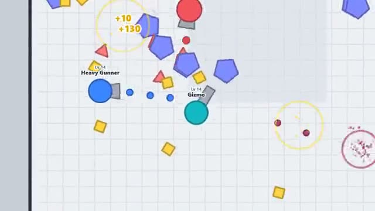

# Tank Upgrades

Shoot shapes, level up, outgun every other tank. A multiplayer starter game from [Multiplayer Agent](https://multiplayeragent.com): 2D, drop-in, 2–16 players, with bots that fill empty seats.

## How it plays

Break shapes for XP. Every level gives you a point for Speed, Reload, Damage or Armor, and at level 10 you pick a new tank: Twin, Sniper or Gunner. Destroy another tank to take half its score.

**Controls:** WASD to move, mouse to aim, click to shoot, 1–4 to upgrade; two thumb sticks on touch.

## Make it yours in the Game Builder

Open the [Game Builder](https://multiplayeragent.com), choose **Start from a starter game** and pick Tank Upgrades. It opens as version 1 in your studio, ready to play and publish. Then ask for changes, for example:

- Add a Flank tank with a second barrel facing backwards
- Make the shapes space rocks and the arena a starfield
- Add a boss shape that spawns in the middle every two minutes

## Run it yourself

1. Get a free publishable key (`pk_…`) at [multiplayeragent.com](https://multiplayeragent.com).
2. In `index.html`, put it in place of `pk_REPLACE_ME` in the `MP_CONNECT` block.
3. Open `index.html` in a browser. No build step and no server needed.

Without a key it still runs, offline against bots.

## How it is built

- One `index.html`. The comment at the top of the script maps the code and explains the multiplayer.
- **Leaderboard:** Each player's best score in one life, shown when you're destroyed.
- **Host-run rules:** The host's browser runs the shapes and decides who broke them; if it leaves, the next player takes over.
- **Bots:** Bots of every level fill the arena until enough people join.
- **Live sync:** Every tank and bullet shows up for everyone at once; whoever gets hit says so.
- `?attract` runs it offline with bots only. The preview video is recorded from it.

## License

MIT.
